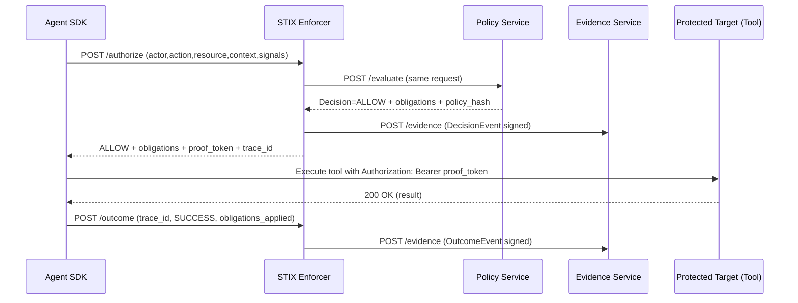
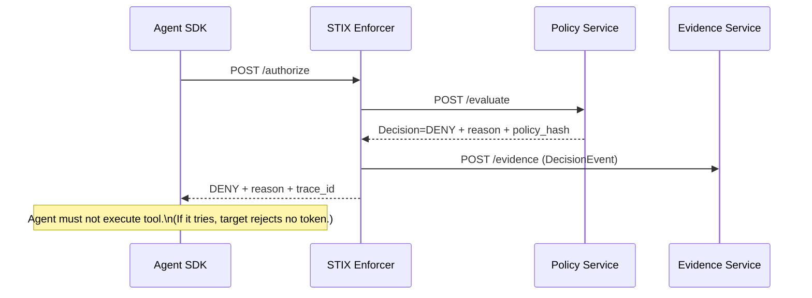
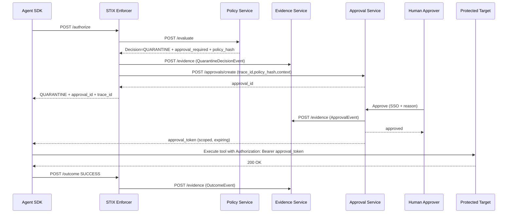
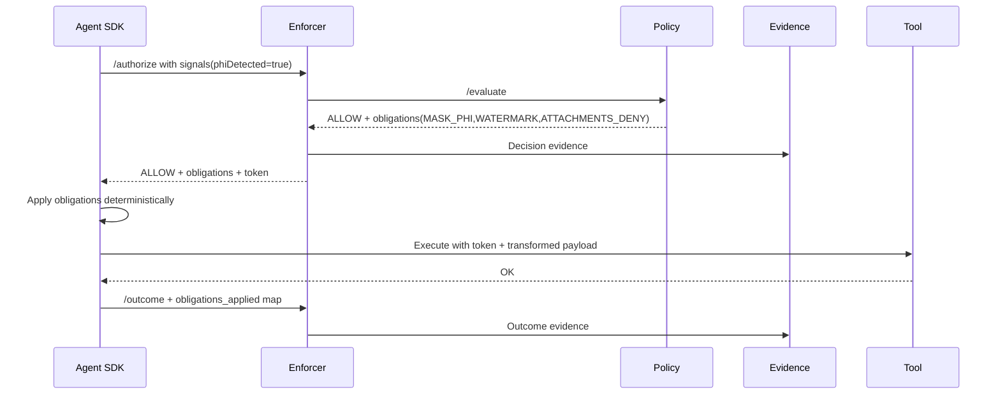
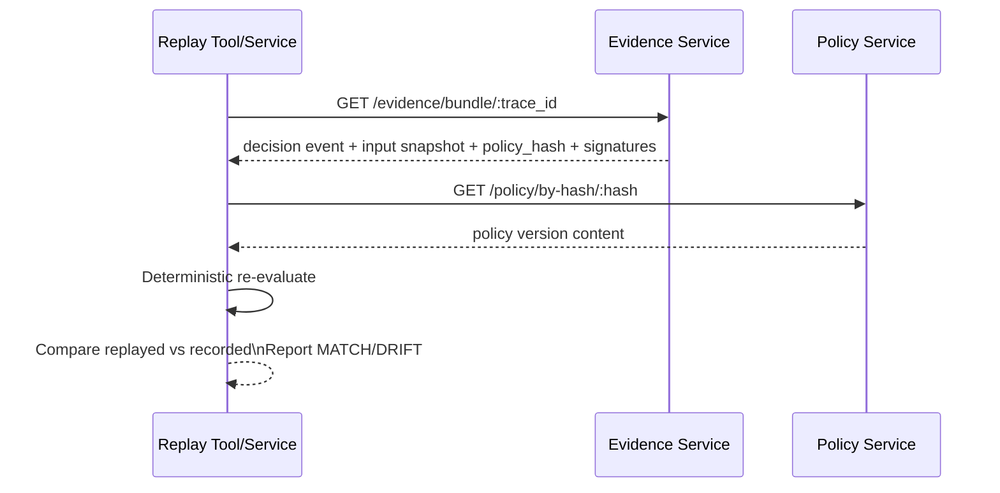

STIX Enterprise Guardrail System

Below is a **full STIX Architecture + Design + Development Specification** (enterprise-grade) using the **Healthcare Claims Agent (HIPAA)** scenario. It’s written as a **build document**: what to implement, how it works, what data looks like, and how it scales + audits.

---

# STIX Enterprise Guardrail System

**Scenario:** Healthcare Claims Agent (HIPAA / PHI)
**Purpose:** Deterministic, un-bypassable enforcement of policies/regulations at execution time, with immutable evidence + replay.

---

## 1) Goals and Non-Goals

### Goals

* **Unavoidable enforcement**: protected targets refuse execution without STIX proof.
* **Deterministic decisions**: same inputs + same policy version → same decision.
* **Policy-as-code lifecycle**: versioned, reviewable, testable, promotable (dev→prod).
* **Evidence by construction**: every decision + outcome produces signed, immutable evidence.
* **Replayability**: reproduce decisions months later using stored input snapshot + policy hash.
* **Enterprise readiness**: tenancy, RBAC, KMS/HSM keys, audit export, SIEM integrations.

### Non-Goals

* Not a SIEM / monitoring console replacement.
* Not a generic “GRC dashboard” product.
* Not allowing “temporary bypass” toggles in UI.

---

## 2) Core Concepts and Mental Models

### STIX is a control plane

* **Decision plane**: evaluates policy and mints proof tokens.
* **Evidence plane**: immutably records what happened.
* **Policy plane**: defines what must happen.

### “No exceptions, no shortcuts” enforcement model

* Agents call **STIX Enforcer** before executing tools.
* Tools are **protected targets** that verify STIX proof tokens.
* If token missing/invalid → **execution fails** even if agent tries to bypass.

### Decision outcomes

* **ALLOW**: action is permitted, may include **obligations**.
* **DENY**: action is blocked.
* **QUARANTINE**: action paused pending human approval; yields approval workflow.

---

## 3) Reference Architecture

### 3.1 High-level component diagram

```text
                    ┌───────────────────────────┐
                    │        Identity (SSO)      │
                    │ OIDC/SAML + RBAC/ABAC      │
                    └─────────────┬─────────────┘
                                  │
┌─────────────────┐     mTLS      │        ┌─────────────────────────┐
│   AI Agent(s)    │──────────────┼────────►  STIX Enforcer Service   │
│ SDK wraps tools  │              │        │  /authorize /outcome     │
└───────┬─────────┘              │        │  token mint + obligations │
        │                         │        └───────┬─────────┬───────┘
        │                         │                │         │
        │                         │      eval      │         │ evidence
        │                         │                │         │
        │                         │     ┌──────────▼───┐    ┌▼────────────────────┐
        │                         │     │ Policy Service │    │ Evidence Service    │
        │                         │     │ compile+index  │    │ append+sign+chain   │
        │                         │     │ /evaluate      │    │ hot + vault export  │
        │                         │     └───────────────┘    └───────┬────────────┘
        │                         │                                  │
        │                         │                                  │
        │      Bearer proof_token │                                  │
        ▼                         │                                  │
┌─────────────────────────┐      │                                  │
│ Protected Targets (Tools)│◄─────┘                                  │
│ email/http/db/doc svc    │ verify token (JWKS/keys)                │
└─────────────────────────┘                                          │
                                                                      │
                                                          ┌──────────▼──────────┐
                                                          │ Vault Store (WORM)    │
                                                          │ S3 Object Lock / Blob │
                                                          └──────────┬──────────┘
                                                                     │
                                                          ┌──────────▼──────────┐
                                                          │ Hot Store (Query)     │
                                                          │ Postgres/ClickHouse   │
                                                          └───────────────────────┘
```

### 3.2 Key “Unavoidability” rule

**Protected targets** must enforce:

* only accept execution if `Authorization: Bearer <STIX proof token>` is valid
* token must bind to: action/resource + trace_id + expiry + policy_hash

---

## 4) Data Flow Summary (What happens in real life)

1. Agent wants to call a tool (email/http/db/doc).
2. SDK builds an **AuthorizeRequest** (actor, action, resource, context, signals).
3. Enforcer → Policy Service `/evaluate` → returns decision + obligations.
4. Enforcer writes **Decision Evidence** (signed, chained) to Evidence Service.
5. If **ALLOW**: Enforcer mints **proof token** (short TTL) and returns it.
6. Agent executes protected target, passes proof token.
7. Target verifies token and executes (or rejects).
8. Agent reports **Outcome** to Enforcer `/outcome` (SUCCESS/FAILED), which writes outcome evidence.
9. Later: Auditor or incident response runs **Replay** using evidence + policy hash.

---

## 5) Component Specifications

### 5.1 STIX Enforcer Service

**Primary purpose:** issue deterministic decision + proof token, and ensure evidence is written.

**Endpoints**

* `POST /authorize`
* `POST /outcome`
* `GET /keys` (or `/.well-known/jwks.json`)
* `GET /health`

**Responsibilities**

* Validate request schema (strict)
* Call Policy Service (`/evaluate`)
* Compute/assign `trace_id`
* Mint proof token if ALLOW
* Emit decision evidence event
* Emit outcome evidence event
* Rate limiting, tenant isolation, request signing (optional)

---

### 5.2 Policy Service (compile + evaluate)

**Primary purpose:** deterministic policy evaluation from versioned policy packs.

**Endpoints**

* `POST /evaluate`
* `GET /policy/by-hash/:hash`
* `POST /reload` (dev-only; prod uses deploy pipeline)
* `GET /health`

**Responsibilities**

* Compile policies into indexed IR
* Deterministic selection:

  * sort by `priority ASC`
  * tie-break by `decision rank` (DENY < QUARANTINE < ALLOW)
  * then `policy_id ASC`
* Return: decision, reason_code, obligations, policy hash, regs/controls.

---

### 5.3 Evidence Service (append-only, signed, chained)

**Primary purpose:** evidence ingestion + immutable storage.

**Endpoints**

* `POST /evidence`
* `GET /evidence/search?trace_id=...`
* `GET /evidence/event/:event_id`
* `GET /evidence/bundle/:trace_id` (export)
* `GET /health`

**Responsibilities**

* Canonicalize event payload
* Compute `event_hash`
* Maintain `prev_hash` hash chain
* Sign event with evidence key (KMS/HSM)
* Write:

  * **Hot store** (queryable)
  * **Vault store** (WORM immutable object)
* Provide evidence bundle export (audit).

---

### 5.4 Approval Service (Quarantine resolution)

**Primary purpose:** handle QUARANTINE.

**Endpoints**

* `POST /approvals/create`
* `POST /approvals/:id/approve`
* `POST /approvals/:id/reject`
* `GET /approvals/pending`

**Responsibilities**

* Create approval record bound to trace_id + policy_hash + action/resource
* Notify approvers (ServiceNow/Jira/Email/Slack)
* On approve: mint **approval token** (one-time / scoped / expiring)
* Emit approval evidence events (who approved, when, why).

---

### 5.5 Protected Targets (Tool services)

**Primary purpose:** execute action only with valid STIX proof.

**Patterns**

* DB Proxy service: `POST /db/read` `POST /db/write` (enforced)
* Email service: `POST /email/send`
* HTTP proxy: `POST /http/request`
* Document fetcher: `POST /docs/download`

**Rules**

* Verify token signature + expiry
* Verify claims:

  * action matches endpoint
  * tenant matches
  * trace_id present
  * policy_hash present
* Optionally call Enforcer introspection (not required if token is self-contained)

---

## 6) Sequence Diagrams

### 6.1 Authorize → ALLOW



### 6.2 Authorize → DENY



### 6.3 Authorize → QUARANTINE (Approval)



### 6.4 Allow-with-Obligations



### 6.5 Replay (Audit)



---

## 7) Data Schema Spec

### 7.1 AuthorizeRequest JSON Schema (core)

```json
{
  "$schema": "https://json-schema.org/draft/2020-12/schema",
  "$id": "stix.authorize.request.schema.json",
  "type": "object",
  "required": ["actor", "action", "resource", "context"],
  "properties": {
    "actor": {
      "type": "object",
      "required": ["id", "type"],
      "properties": {
        "id": { "type": "string" },
        "type": { "enum": ["HUMAN", "SERVICE", "AI_AGENT", "JOB"] },
        "role": { "type": "string" },
        "tenant": { "type": "string" },
        "attributes": { "type": "object", "additionalProperties": true }
      }
    },
    "action": { "type": "string" },
    "resource": {
      "type": "object",
      "required": ["type"],
      "properties": {
        "type": { "type": "string" },
        "id": { "type": "string" },
        "classification": { "type": "array", "items": { "type": "string" } },
        "attributes": { "type": "object", "additionalProperties": true }
      }
    },
    "context": {
      "type": "object",
      "required": ["env"],
      "properties": {
        "env": { "enum": ["dev", "test", "stage", "prod"] },
        "purpose": { "type": "string" },
        "run_id": { "type": "string" },
        "session_id": { "type": "string" },
        "ticket_id": { "type": "string" },
        "jurisdiction": { "type": "string" },
        "tags": { "type": "array", "items": { "type": "string" } },
        "signals": {
          "type": "object",
          "additionalProperties": false,
          "properties": {
            "piiDetected": { "type": "boolean" },
            "phiDetected": { "type": "boolean" },
            "pciDetected": { "type": "boolean" },
            "secretsDetected": { "type": "boolean" }
          }
        },
        "attributes": { "type": "object", "additionalProperties": true }
      }
    },
    "tool_call": {
      "type": "object",
      "properties": {
        "tool": { "type": "string" },
        "risk_tier": { "enum": ["LOW", "MEDIUM", "HIGH", "CRITICAL"] },
        "args_summary": { "type": "string" }
      }
    }
  }
}
```

### 7.2 DecisionResponse JSON Schema (from Enforcer)

```json
{
  "$id": "stix.decision.response.schema.json",
  "type": "object",
  "required": ["decision", "reason_code", "trace_id", "policy", "obligations"],
  "properties": {
    "decision": { "enum": ["ALLOW", "DENY", "QUARANTINE"] },
    "reason_code": { "type": "string" },
    "trace_id": { "type": "string" },
    "policy": {
      "type": "object",
      "required": ["id", "version", "hash"],
      "properties": {
        "id": { "type": "string" },
        "version": { "type": "string" },
        "hash": { "type": "string" }
      }
    },
    "obligations": {
      "type": "array",
      "items": {
        "type": "object",
        "required": ["type"],
        "properties": {
          "type": { "type": "string" },
          "params": { "type": "object", "additionalProperties": true }
        }
      }
    },
    "approval": { "type": ["object", "null"], "additionalProperties": true },
    "proof_token": { "type": "string" }
  }
}
```

### 7.3 Evidence Event Schema (append-only)

```json
{
  "$id": "stix.evidence.event.schema.json",
  "type": "object",
  "required": ["schema_version", "event_id", "timestamp", "trace_id", "event_type", "integrity", "payload"],
  "properties": {
    "schema_version": { "type": "string" },
    "event_id": { "type": "string" },
    "timestamp": { "type": "string", "format": "date-time" },
    "trace_id": { "type": "string" },
    "event_type": { "enum": ["DECISION", "OUTCOME", "APPROVAL", "POLICY_PUBLISH"] },
    "payload": { "type": "object", "additionalProperties": true },
    "integrity": {
      "type": "object",
      "required": ["event_hash", "prev_hash", "signature", "key_id"],
      "properties": {
        "event_hash": { "type": "string" },
        "prev_hash": { "type": "string" },
        "signature": { "type": "string" },
        "key_id": { "type": "string" }
      }
    }
  }
}
```

---

## 8) Field-level semantics (what must be true)

* `trace_id`: correlates the entire authorization→execution→outcome chain.
* `policy.hash`: hash of the exact policy version used to decide.
* `reason_code`: stable code (not free text) for audit reporting.
* `signals`: derived by classifiers (agent-side, DLP, or both).
* `resource.attributes`: includes **boundary markers** like destination type, recipient type, data zone.
* `obligations`: instructions that must be applied deterministically.
* `obligations_applied`: recorded in outcome evidence to prove enforcement happened.

---

## 9) Canonicalization Rules (mandatory for defensibility)

**Canonical JSON**

* UTF-8
* Keys sorted lexicographically at all object levels
* No insignificant whitespace
* Arrays preserve order
* Numbers encoded consistently (avoid floats; use integers/strings for money/ids)
* `signature` field excluded when computing `event_hash`

**Hash**

* `event_hash = sha256(canonical_json_without_signature)`
* `prev_hash` links to previous event’s `event_hash` for tamper-evident chain

**Sign**

* Sign `event_hash` (or sign canonical bytes directly; preferred)
* Signature uses KMS/HSM-backed key

**Vault write-once**

* Vault store enforces WORM retention (Object Lock / immutable blob)

---

## 10) Token Format (Proof that makes targets unavoidable)

### Proof token requirements

* Short TTL (e.g., 30–60 seconds)
* Signed (EdDSA or RS256; enterprise often prefers RS256/JWKS)
* Claims must bind to:

  * `tid` (trace_id)
  * `act` (action)
  * `res` (resource type)
  * `tenant`
  * `pol` (policy hash)
  * `iat`, `exp`

### Suggested JWT claims

```json
{
  "iss": "stix",
  "sub": "agent-42",
  "tenant": "acme",
  "tid": "stix_...",
  "act": "SEND_EXTERNAL",
  "res": "MESSAGE",
  "pol": "sha256:....",
  "cls": ["PHI"],
  "iat": 1730000000,
  "exp": 1730000045
}
```

### Target verification rules

* Signature valid via JWKS
* `exp` not expired
* `act` matches endpoint (SEND_EXTERNAL cannot call DB_READ endpoint)
* `tenant` matches tool’s tenant partition
* optional: `aud` matches tool service audience

---

# 11) Security Appendix

## 11.1 Key management

**Keys**

* Token signing keys: rotate regularly (30–90 days)
* Evidence signing keys: KMS/HSM, rotate with strict audit
* mTLS certs: rotate with service mesh or PKI

**Storage**

* Private keys never in app config in prod
* Use:

  * AWS KMS + CloudHSM (optional)
  * Azure Key Vault + Managed HSM
  * GCP KMS + Cloud HSM

## 11.2 mTLS and service identity

* Enforcer ↔ Policy, Enforcer ↔ Evidence: mTLS required
* SPIFFE/SPIRE recommended in Kubernetes
* Each service has a unique identity + least privilege

## 11.3 AuthN/AuthZ

* Human flows use OIDC/SAML (SSO)
* Service-to-service uses mTLS + JWT client credentials
* RBAC/ABAC:

  * Policy authoring: SecurityArchitect, ComplianceLead
  * Approvals: PrivacyOfficer, SecurityOfficer
  * Evidence export: Auditor role
  * Field-level access: PHI visibility gated

## 11.4 Incident response

* **Kill switch policy**: emergency deny for high-risk actions
* Key compromise:

  * rotate signing key immediately
  * revoke JWKS key id
  * log “key rotation event” as evidence
* Evidence tamper attempt:

  * chain verification fails → incident trigger
  * vault immutability prevents rewrite; hot store changes are detected by vault mismatch

## 11.5 Rate limiting & abuse

* Enforcer endpoints protected with:

  * per-tenant limits
  * per-agent limits
  * request size limits
* Proof tokens short TTL reduces replay window
* Optionally include nonce / jti for one-time execution (cost tradeoff)

---

# 12) Storage and Retrieval Design

## 12.1 Hot store (query)

**Preferred**: Postgres (simple) or ClickHouse (high volume)

Indexes:

* `(trace_id)`
* `(timestamp)`
* `(tenant, decision)`
* `(policy_id, policy_hash)`
* `(reason_code)`
* `(actor_id, action)`

## 12.2 Vault store (immutable)

* S3 Object Lock (COMPLIANCE mode) / Azure Immutable Blob
* Object keying:

  * `/tenant=<t>/date=YYYY-MM-DD/event_id.json`
* Evidence bundle export uses vault objects as source of truth

## 12.3 Evidence bundle export

For audits, export:

* decision event(s)
* outcome event(s)
* approval event(s) if any
* policy content by hash
* verification manifest:

  * chain root hash
  * key IDs used
  * signatures

---

# 13) Policy Lifecycle and Governance

## 13.1 GitOps workflow (recommended)

* Policies live in repo `policies/`
* PR requires:

  * schema validation
  * deterministic tests
  * simulation results on recent traces (optional)
  * approvals from designated roles
* Release pipeline publishes:

  * `policy_pack_version`
  * signed policy manifest
  * policy hash index

## 13.2 Policy evaluation determinism

* No “best effort”
* No LLM-driven policy decisions
* Pure deterministic rules + deterministic ordering

## 13.3 Policy packs (how you win enterprise adoption)

Provide prebuilt packs:

* HIPAA pack (PHI egress, access logging, approvals)
* PCI pack
* SOX pack
* SOC2 / ISO pack

Each pack includes:

* control library mapping
* policies
* test suite
* documentation

---

# 14) “STIX Reference Implementation Plan”

## 14.1 Repo structure (recommended)

```text
stix/
  services/
    enforcer/
    policy/
    evidence/
    approvals/
    target-email/
    target-http/
    target-db/
    target-docs/
  sdk/
    agent-sdk/
    target-verifier/
    policy-authoring-cli/
  policies/
    packs/
      hipaa/
      pci/
      sox/
    tests/
  infra/
    k8s/
    helm/
    terraform/
  tools/
    stix-replay/
    stix-verify/
    stix-simulate/
```

## 14.2 Interfaces (contracts)

* `AuthorizeRequest` and `DecisionResponse` as versioned contracts
* Evidence schema as versioned contract
* Token format as contract (JWKS / kid rotation)

## 14.3 Test strategy

**Unit tests**

* policy evaluator: matching, priority ordering, tie-breakers
* canonicalization correctness
* token mint/verify

**Integration tests**

* allow/deny/quarantine flows end-to-end
* target reject w/out token
* obligations applied and recorded

**Security tests**

* replay token attempt (expired tokens)
* wrong audience/action misuse
* evidence chain verification
* tamper hot store vs vault verification

**Compliance tests**

* export bundle verifier
* replay tool reproduces decisions

## 14.4 Deployment manifests (Kubernetes)

* Separate namespaces per environment
* NetworkPolicies deny-by-default
* mTLS via service mesh
* Secrets via external secrets operator
* Vault store configured with retention policies
* Horizontal scaling for enforcer/policy services

---

# 15) How STIX Evolves (enterprise maturity roadmap)

**v1 (adopt fast)**

* Enforcer + Policy + Evidence + Target Verifier
* 3 protected targets (email/http/db)
* Policy pack HIPAA core (10–20 policies)

**v2 (remove enterprise fear)**

* Approvals service + audit bundle export
* Replay + simulation service (impact analysis)

**v3 (scale governance)**

* Multi-tenant overlays, jurisdiction rules
* Policy authoring UI (minimal: policies, approvals, evidence, replay)

**v4 (deep compliance)**

* Control library standardization, attestations
* Continuous compliance drift detection
* Integrations: SIEM, DLP, data catalogs

---

## Next: I can turn this into two concrete deliverables

1. **A complete HIPAA policy pack (20–30 policies)** with priorities + obligations + tests
2. A **full set of JSON Schemas** (Authorize/Decision/Evidence/Approval) + a **bundle verifier** CLI

Say which one you want first: **“HIPAA policy pack”** or **“Schemas + verifier.”**